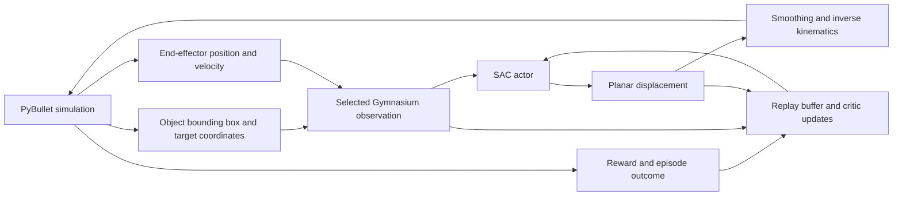

# Multimodal reinforcement learning for robotic pushing

A simulated Franka Panda learns to push objects into a target in PyBullet. The experiments use Soft Actor-Critic (SAC) to compare vision, robot state, goal information, and reward design.

[Research and reproduction notes](docs/reproduction.md) · [Experiment results](results/) · [Demo video](results/videos/multimodal-hard-replay.mp4) · [Cite this project](#citation)


The archived multimodal checkpoint reached the target in **27 steps** on this selected hard-difficulty spawn. [Watch the MP4](results/videos/multimodal-hard-replay.mp4)

## How the policy works



The policy receives numerical features from simulator segmentation and robot state. It outputs a continuous two-dimensional displacement. The controller smooths the action, computes joint targets with inverse kinematics, and maintains a fixed pushing height. During training, SAC learns from replayed transitions with an entropy objective that encourages exploration. The curriculum expands the object spawn range through five difficulty levels as performance improves. [Soft Actor-Critic paper](https://proceedings.mlr.press/v80/haarnoja18b.html)

## What the experiments compare

| Checkpoints | Comparison |
| --- | --- |
| `checkpoints/models_exp_02_*` | Early curriculum and reward configuration |
| `checkpoints/models_exp_03_*` to `checkpoints/models_exp_06_*` | Vision with goal, proprioception, vision plus proprioception with goal, and vision plus proprioception without goal |
| `checkpoints/models_exp_07_*` | Shaped and sparse rewards |
| `checkpoints/models_exp_08_*`, `checkpoints/models_exp_09_*` | Object-centric and robot-centric observations |
| `checkpoints/models_exp_10_*`, `checkpoints/models_exp_11_*` | Varying target positions with and without explicit goal input |

In the archived training runs, multimodal observations performed better than either single modality. Runs with explicit goal input and shaped rewards reached high success rates earlier. In a three-episode replay per checkpoint, the goal-conditioned multimodal policy reached the target twice, the multimodal policy without goal input reached it once, and the single-modality policies timed out. [Archived curves](results/plots/) · [Replay protocol and results](docs/reproduction.md#checkpoint-replay)

## Run it locally

Use Linux x86-64 and Python 3.11. Python 3.11 has a prebuilt PyBullet wheel with NumPy support. If building PyBullet from source on a newer Python, enable NumPy support. The pinned PyTorch wheel uses CUDA 13. CPU evaluation works without a GPU. GPU acceleration requires a compatible NVIDIA driver from the R580 series or newer.

From the repository root, create an environment and fetch the external object models at the revision used for the reproduction.

```bash
python3.11 -m venv .venv
source .venv/bin/activate
python -m pip install -r requirements.txt

git clone https://github.com/GPT-RL/pybullet-URDF-models.git ../pybullet-URDF-models
git -C ../pybullet-URDF-models checkout 0f00cd5f7a4f5a5db893c2141c890f9b2e995431
export PYTHONPATH="$(realpath ../pybullet-URDF-models)${PYTHONPATH:+:$PYTHONPATH}"
```

### Record a policy

The recording command works headlessly. Add `--render` to open the simulator window. `--randomize-spawn` samples within the selected difficulty range using `--seed`. Stable Baselines3 checkpoint metadata can execute code during loading, so pass `--trust-checkpoint` only for a file you trust. YAML cannot grant this permission.

```bash
mkdir -p outputs/demo
python scripts/reference/agent_training.py \
  --run-episode --record --seed 36 --randomize-spawn \
  --difficulty-level 3 --max-steps 150 --observation-type multimodal --trust-checkpoint \
  --load-model checkpoints/models_exp_05_multimodal/interrupted_model_sac_20250327_083255.zip \
  --video-path outputs/demo/multimodal.mp4
```

### Train from scratch

This smoke test exercises environment setup, training, and model export. The archived experiments ran for millions of timesteps.

```bash
python scripts/reference/agent_training.py \
  --total-timesteps 64 --learning-starts 32 --buffer-size 1024 \
  --batch-size 32 --max-steps 100 --n-eval-episodes 1 --seed 42 \
  --observation-type multimodal --model-dir outputs/demo/models \
  --log-dir outputs/demo/logs
```

## Repository guide

| Path | Purpose |
| --- | --- |
| [scripts/reference/](scripts/reference/) | Reference simulator, trainer, and full training command |
| [scripts/launchers/](scripts/launchers/) | Shell commands for training, evaluation, and checkpoint sweeps |
| [scripts/](scripts/) | Experiment variants, evaluation, plotting, and prototypes |
| [config/train/](config/train/) | YAML configuration for staged training |
| [config/archive/](config/archive/) | Historical run snapshots, including paths from the original system |
| [checkpoints/](checkpoints/) | Released model archives, grouped by experiment |
| [results/](results/) | Archived metrics, plots, and [recorded rollouts](results/videos/) |
| [docs/](docs/) | Research and reproduction notes, workspace figures, and segmentation examples |

Generated recordings go to `outputs/videos/` unless you pass `--video-path`. To regenerate the goal-conditioning plot from the archived CSVs, run `python scripts/plot_results.py`. It writes to `outputs/plots/`.

### Paths in earlier checkouts

| Previous path | Current path |
| --- | --- |
| Root `run_*.sh` scripts | `scripts/launchers/run_*.sh` |
| Root `models_*/` folders | `checkpoints/models_*/` |
| `videos/` | `results/videos/` |

## Citation

If you use this software in your work, cite it with the BibTeX entry below. [Citation metadata](CITATION.cff)

```bibtex
@misc{patel_robotic_pushing,
  author = {Patel, Kevin},
  title  = {Multimodal Vision-Guided Reinforcement Learning for Robotic Object Pushing},
  url    = {https://github.com/kvnptl/rl_project}
}
```
